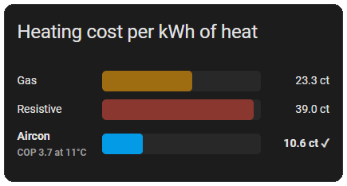

# Heat cost card

A Home Assistant Lovelace card that shows the cost per kWh of heat from gas, resistive heaters and aircon, so you can see which is cheapest right now.

- Gas: gas price ÷ gas energy content ÷ boiler efficiency
- Resistive: electricity price
- Aircon: electricity price ÷ COP, with COP estimated from the outside temperature

## Example



## Install

### HACS

1. In HACS, open the three-dot menu and choose Custom repositories.
2. Add this repository's URL with the type Dashboard.
3. Install "Heat Cost Card" and hard-refresh the browser.

HACS registers the resource for you.

### Manual

1. Download `heat-cost-card.js` from the latest release, or build it:

   ```bash
   npm install
   npm run build
   ```

2. Copy `dist/heat-cost-card.js` to `/config/www/community/heat-cost-card/heat-cost-card.js`.
3. Add `/local/community/heat-cost-card/heat-cost-card.js` as a JavaScript module under Settings → Dashboards → Resources.
4. Hard-refresh the browser and add a "Heat cost card".

## Configuration

```yaml
type: custom:heat-cost-card
gas_price_entity: sensor.gas_price
electricity_price_entity: sensor.electricity_price
outside_temp_entity: sensor.outside_temperature
# Optional, shown with defaults:
title: Heating cost per kWh of heat
currency: "€"
boiler_efficiency: 90      # %
gas_kwh_per_m3: 9.77
cop_at_7c: 3.2             # aircon efficiency at 7°C
cop_per_degree: 0.12       # COP change per °C
cop_min: 1.5
cop_max: 5
```

Electricity may be in €/kWh or ct/kWh. Gas may be in €/m³ or €/kWh. A °F temperature sensor is converted to °C. Costs show as "ct" when `currency` is `€`, otherwise as the plain value with the currency symbol.

The COP model is a straight-line estimate. Set `cop_at_7c` and `cop_per_degree` from your unit's spec sheet.

## Development

```bash
npm run watch   # rebuild dist/ on every change to src/
```

## Use of AI

This code was 100% AI generated. Take it or leave it.